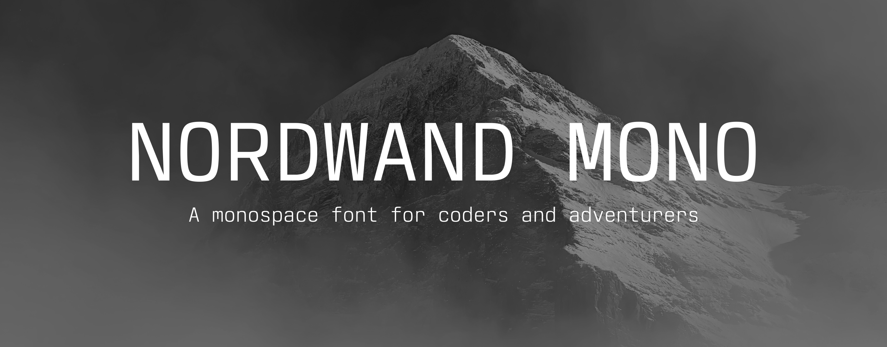
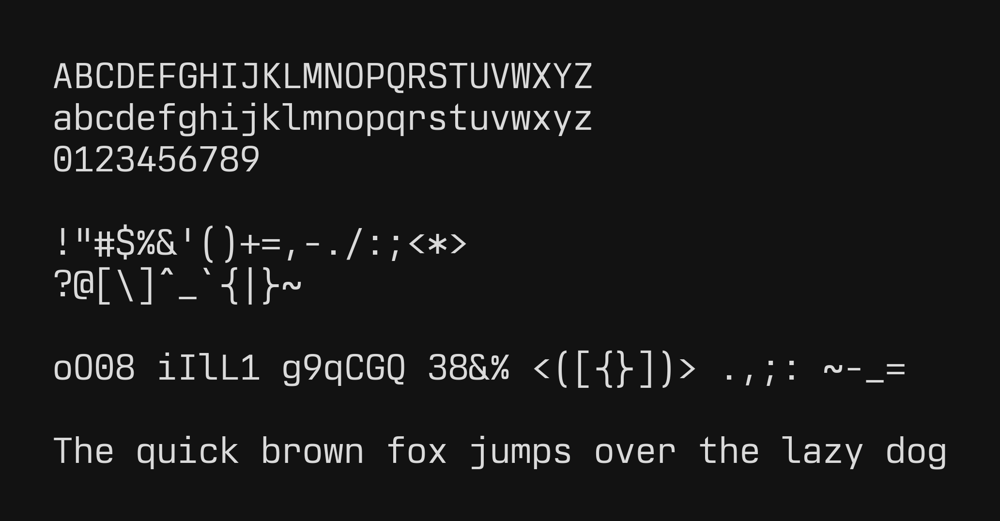
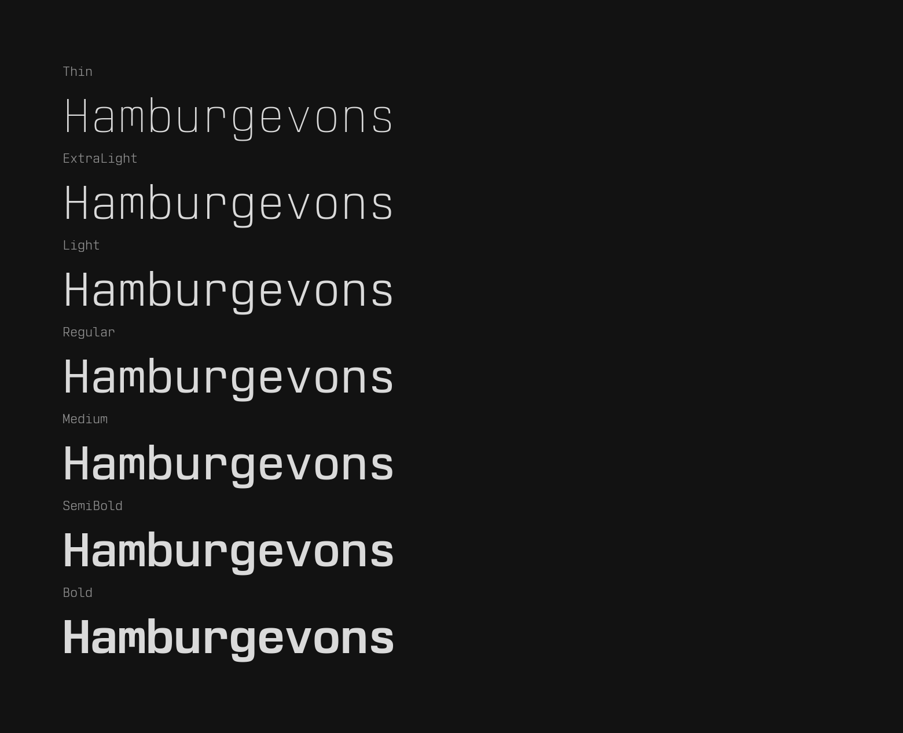
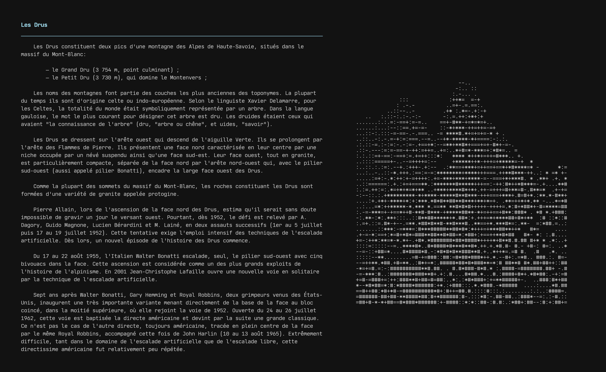
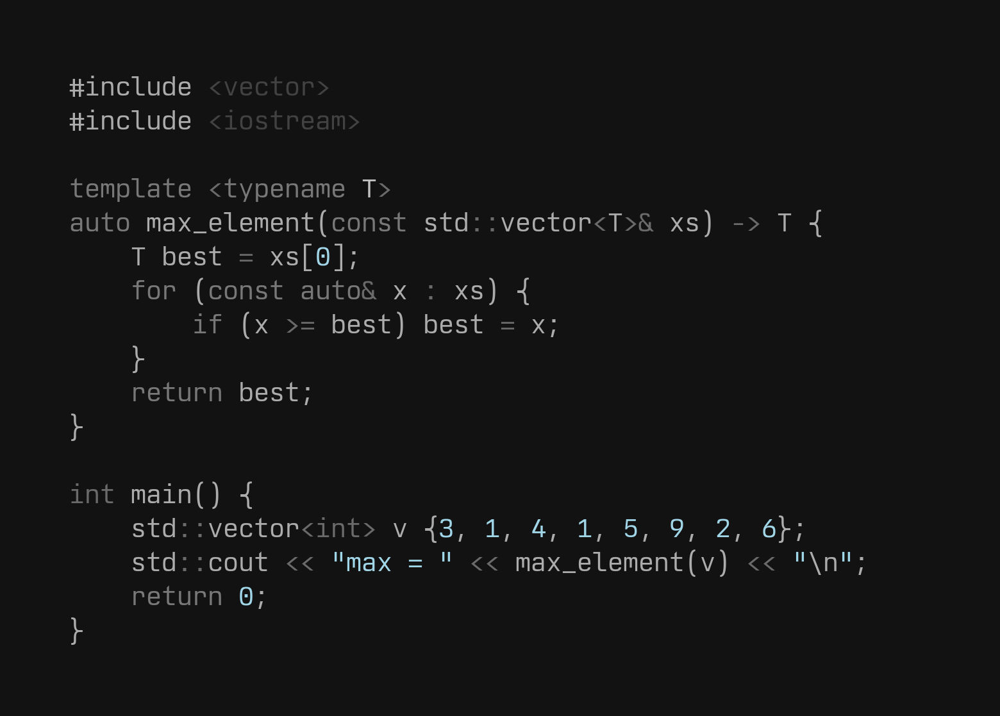
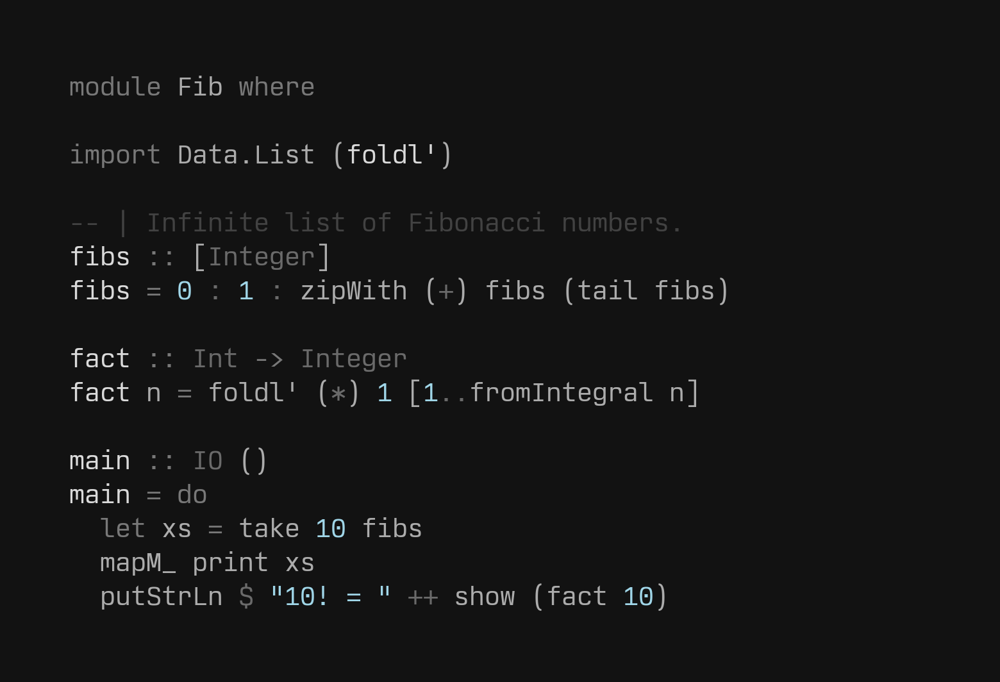
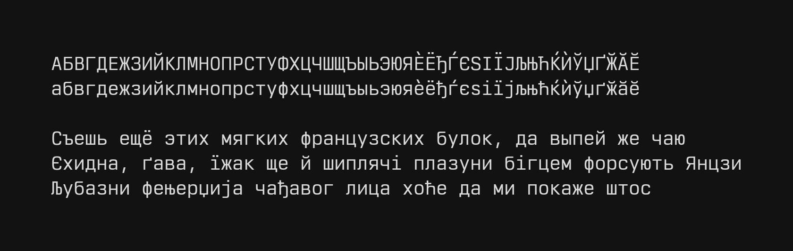
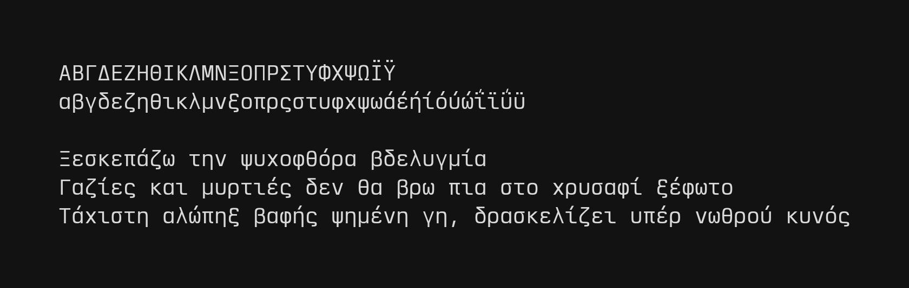
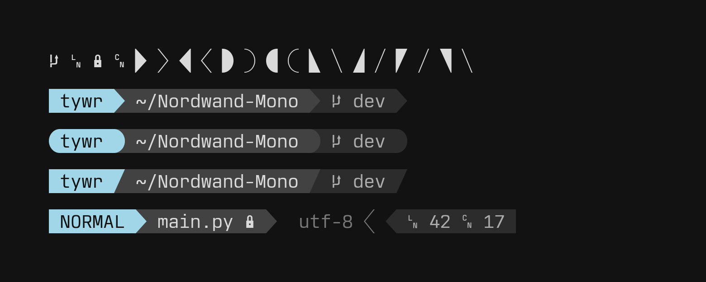

Nordwand Mono is a compact neo-grotesk monospaced typeface designed for programming. Every glyph is drawn procedurally in Python, so the metrics and stroke weights can be adjusted to produce custom builds.

See the [specimen (PDF)](specimens/specimen.pdf) for an overview of the character set and weights.

## Design

Nordwand Mono combines elements of Adrian Frutiger's Univers with the proportions of JetBrains Mono. The name refers to the north faces (*Nordwände*) of the Swiss Alps, and to the Swiss typographic tradition the design draws on.

Other references include:

- Univers (Adrian Frutiger)
- SF Pro and SF Mono (Apple)
- Alpes Mono (Sharp Type)
- Ubuntu Mono (Dalton Maag)
- Berkeley Mono (U.S Graphic Company)

## OpenType features

### Character variants

Alternative designs are available for several characters. See [alternative characters](doc/alternative_characters.md) for a visual comparison and the corresponding feature tags.

### Stylistic sets

Stylistic sets switch groups of related glyphs at once:

| Tag | Effect |
| --- | --- |
| `ss02` | Arrow ligatures |
| `ss03` | Wide-angled `<`, `>` and arrow heads |

See [stylistic sets](doc/stylistic_sets.md) for details and for instructions on enabling them in common editors and terminals.

### Ligatures

The font includes minimal `->` and `=>` ligatures. Runs of `=`, `-`, `_` and `#` can use joining forms, so their horizontal bars connect across runs of any length. Joining forms are disabled by default and are enabled with the `dlig` feature.

## Installation

Prebuilt font files are attached to each [release](../../releases).

## Building from source

Requirements: [uv](https://docs.astral.sh/uv/getting-started/installation/).

```sh
make install     # install the Python dependencies
make build-font  # build TTF, WOFF and WOFF2 into ./fonts
make build       # build the fonts, banner, specimen, samples and docs
```

### Nerd Font variant

Nerdwand Mono is the [Nerd Font](https://www.nerdfonts.com) variant of Nordwand Mono, patched with the complete icon set. Icons occupy a single cell, so the font remains strictly monospaced. It is not attached to releases and must be built locally:

```sh
make build
make build-nerd-font
```

This additionally requires [FontForge](https://fontforge.org) (`brew install fontforge` on macOS, `apt install fontforge python3-fontforge` on Debian and Ubuntu), and network access on the first run to download the Nerd Fonts patcher. The patched fonts, the font license and the licenses of the bundled icon sets are written to `./fonts/nerd-font`.

## Custom builds

Each glyph is a Python class drawn from a drawing context that holds the font metrics (x-height, cap height, stroke weights, etc.). Overriding these values produces a custom build.

1. Copy `config.example.yml` to `config.yml` and edit the values.
2. Preview individual glyphs:

   ```sh
   uv run python -m visualize --config config.yml lowercase_a
   ```

3. Build the fonts:

   ```sh
   uv run python -m generate_font --config config.yml
   ```

   The files are written to `./custom-fonts/<FamilyName>`, so they do not overwrite the default build.

> [!WARNING]
> The design is tuned for the default metrics. Some glyphs may need adjustments when the metrics are changed.

### Example configurations

The [`configs`](configs) folder contains alternative configurations, each with a `config.yml` and a `sample.png` rendered from it. To add one, create `configs/<name>/config.yml` and run:

```sh
uv run python -m scripts.config_sample <name>
```

This builds the Regular weight (or another weight with `--weight`) and writes `configs/<name>/sample.png`.

### Weights

The stroke widths in the configuration define the Regular weight; all other weights are derived from them. To select which weights are exported, or to give a weight explicit stroke widths, add a `weights` section:

```yaml
weights:
  400:
  425:
    name: Book
    stroke_x: 90   # vertical strokes
    stroke_y: 84   # horizontal strokes
    stroke_alt: 72 # crossbars, e.g. the bar of e
  700:
```

Only the listed weights are built.

## Character set



The font covers Latin (including the accented letters of most European languages) and Cyrillic.

It also includes the [Powerline](https://github.com/powerline/powerline) symbols (U+E0A0–U+E0A3) and segment dividers (U+E0B0–U+E0BF): arrows, rounded ends, corner triangles and diagonals. The dividers span the full line height and slightly overlap the adjacent cell, so status lines render without the Nerd Font variant.

## Weights



## Samples



### Python


### C++



### Haskell



### Cyrillic



### Greek



### Powerline



## License

The font files are licensed under the [SIL Open Font License 1.1](LICENSE-FONT.txt). The source code is licensed under the [MIT License](LICENSE.txt).
