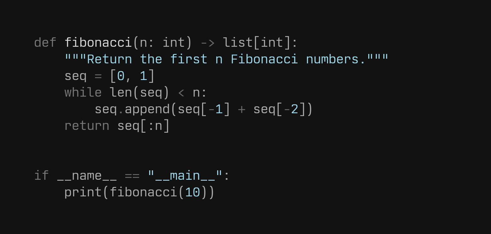
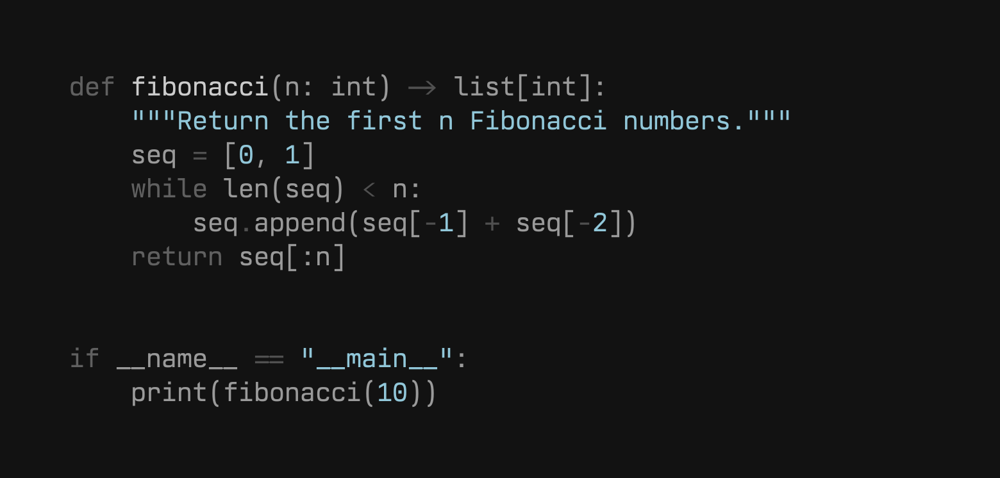

# Custom configurations

Each folder holds a `config.yml` overriding the default metrics, and a `sample.png` rendered with it. Regenerate a sample with `python -m scripts.config_sample <name>`.

| Build | Folder | x-height | Cap height | Ascender | Descender |
| --- | --- | --- | --- | --- | --- |
| Nordwand Mono (reference) | – | 540 | 710 | 750 | −185 |
| Nordley Mono | [`nordley`](nordley/config.yml) | 518 | 680 | 734 | −215 |
| Nord Francisco Mono | [`NF`](NF/config.yml) | 529 | 705 | 738 | −179 |
| Nordwand Mono LoDPI | [`LoDPI`](LoDPI/config.yml) | 540 | 710 | 750 | −185 |

## Nordwand Mono (reference)

## Nordley Mono

## Nord Francisco Mono

## Nordwand Mono LoDPI

Same metrics as the reference, exporting Regular, Bold and a heavier Book (425) weight for non-Retina (1x) screens, where macOS ignores hinting and the regular horizontals (70 units, about 0.9 px at 13 px) render faint. Book's horizontals match the Regular verticals (`stroke_y` 84) and its other strokes are slightly thicker (`stroke_x` 90, `stroke_alt` 72). The sample shows Book (`python -m scripts.config_sample LoDPI --weight 425`).

