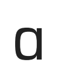
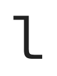

# Alternative Characters

<!-- Generated by `python -m scripts.alternatives_markdown`. -->

| Feature | Character | Code point | Default | Alternative | Alternative glyph | Comment |
| --- | --- | --- | --- | --- | --- | --- |
| `cv01=1` | `0` | `U+0030` |  |  | `zero_slashed` |  |
| `cv01=2` | `0` | `U+0030` |  |  | `zero_hexagon` | Berkeley Mono zero style |
| `cv02=1` | `a` | `U+0061` |  |  | `lowercase_a_3` | Only for italic |
| `cv03=1` | `l` | `U+006C` |  |  | `lowercase_l_2` |  |
| `cv04=1` | `g` | `U+0067` |  |  | `lowercase_g_2` |  |
| `cv11=1` | `f` | `U+0066` |  |  | `lowercase_f_3` |  |
| `cv11=1` | `f` | `U+0066` |  |  | `lowercase_f_4` |  |
| `cv12=1` | `m` | `U+006D` |  |  | `lowercase_m_2` |  |
| `cv19=1` | `3` | `U+0033` |  |  | `three_2` |  |
| `cv20=1` | `ß` | `U+00DF` |  |  | `sharp_s_2` |  |
| `ss03=1` | `>` | `U+003E` |  |  | `greater_than_sign_2` | Also changes the `->` and `=>` arrows |
| `ss03=1` | `<` | `U+003C` |  |  | `less_than_sign_2` |  |
